<div align="center">

# ⚡ NextGen Builds

**The AI-assisted PC architect that eliminates hardware bottlenecks, simulates real-world frametimes, and tracks live component pricing.**

[](https://react.dev/)
[](https://vitejs.dev/)
[](https://tailwindcss.com/)
[](https://threejs.org/)
[](https://opensource.org/licenses/MIT)

<br />

<p align="center">
  <a href="#-the-problem--vision">Why NextGen Builds?</a> •
  <a href="#-key-features">Key Features</a> •
  <a href="#-interface-walkthrough">Interface Walkthrough</a> •
  <a href="#-system-architecture">Architecture</a> •
  <a href="#-tech-stack">Tech Stack</a> •
  <a href="#-getting-started">Getting Started</a>
</p>

---

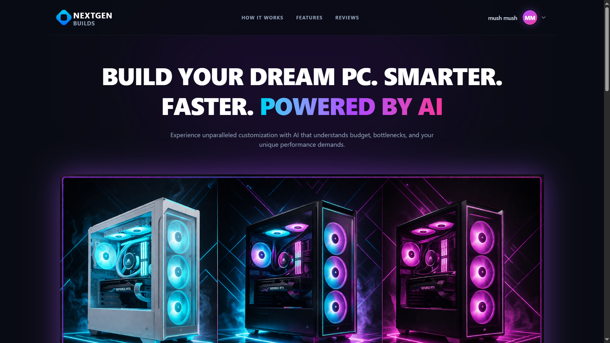

</div>

<br />

## 💡 The Problem & Vision

Building a PC should be thrilling, not exhausting. Most builders spend days switching between half a dozen tabs: calculating power budgets, reading forum debates about PCIe lanes, and guessing whether a specific CPU/GPU pair will cause stuttering at 1440p. 

**NextGen Builds** was created to replace the guesswork with clean, data-driven intelligence:

1. **No Hardware Mismatches:** Every suggested component is cross-referenced for socket compatibility, clearance, and PSU headroom.
2. **Real Frametimes, Not Generic Scores:** An integrated machine-learning regression model predicts real FPS figures and 1% low stability across modern games.
3. **No Overpaying:** Direct price checks across major retailers (Amazon, Newegg, Best Buy) help you assemble within your exact budget limit.

---

## ✨ Key Features

### 🎯 1. Tailored Configuration Paths
Not everyone thinks in clock frequencies and socket pin counts. NextGen Builds provides two distinct entry points:

- **The Smart Assistant (Beginner):** Select your target budget (with an interactive slider), intended use-case (Gaming, Video Editing, Office, Streaming), preferred resolution (1080p, 1440p, 4K), and networking requirements. The AI engine handles the component synergy automatically.
- **The Pro Configurator (Enthusiast):** Full manual control over silicon tiers (Intel Core Ultra, AMD Ryzen 7000/9000), graphics architecture (NVIDIA RTX, AMD Radeon, Intel Arc), memory capacity, and target wattage.

<div align="center">
  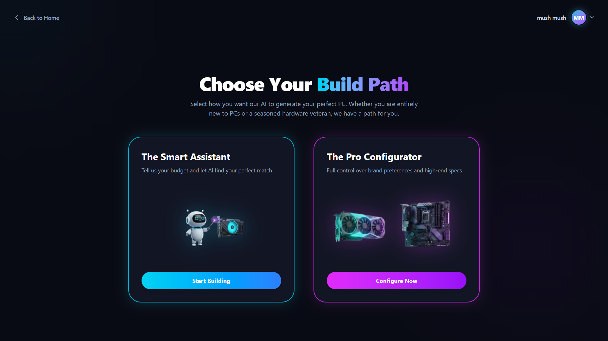
  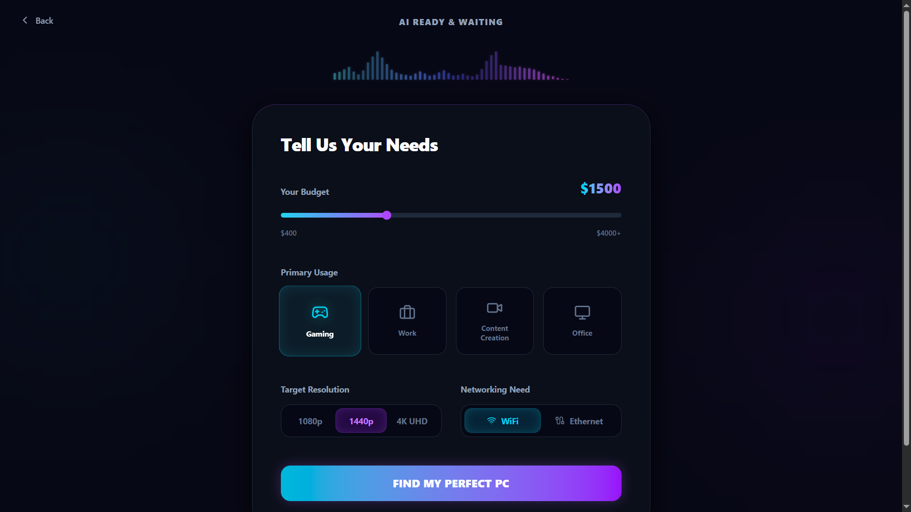
</div>

---

### 🖥️ 2. The Diagnostic Terminal & Bottleneck Telemetry
Once a rig is assembled, the engine passes it through our hardware diagnostic suite:

- **CPU / GPU Synergy Index:** Live calculation of hardware variance to detect any processing bottleneck before spending a dollar.
- **1% Low Stability Rating:** Measures frametime consistency so you can anticipate micro-stutters.
- **Hardware Matrix Verification:** Confirms motherboard socket alignment, RAM dual-channel optimization, case clearance, and a mandatory 20%+ PSU wattage safety buffer.
- **Frametime Curve Prediction:** Visual telemetry graph modeling frame delivery consistency under sustained load.

<div align="center">
  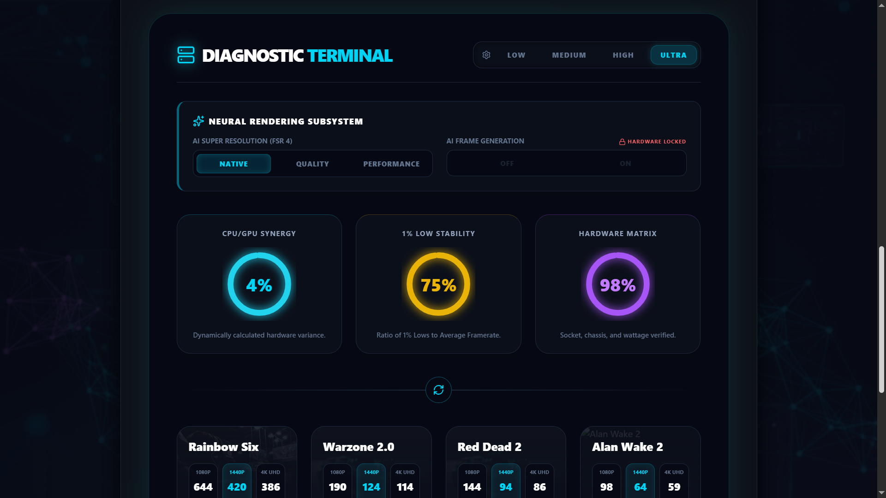
  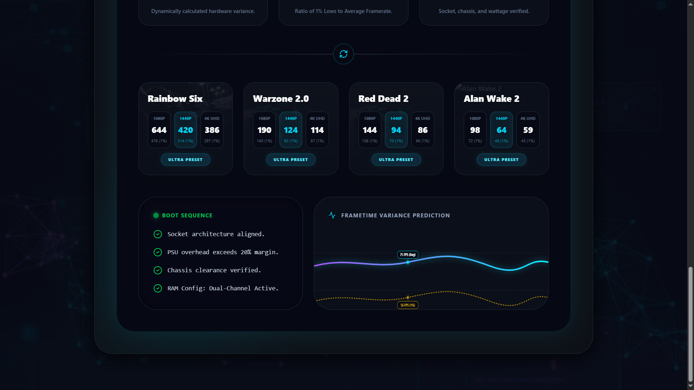
</div>

---

### 🎮 3. Neural FPS Benchmarks & Upscaling Simulation
See how your rig actually performs in demanding modern titles including *Alan Wake 2*, *Red Dead Redemption 2*, *Warzone 2.0*, and *Rainbow Six*:

- Multi-resolution benchmarks (1080p Ultra, 1440p High, 4K Native).
- **Neural Rendering Subsystem:** Toggle DLSS, FSR 4, and AI Frame Generation simulations to see the projected frame rate uplift in real time.

---

### ⚔️ 4. The Versus Matrix (Side-by-Side Build Comparison)
Save your custom configurations in your personal hangar and pit any two builds against each other in the Versus Matrix:

- **Combatant Alpha vs. Combatant Beta:** Head-to-head performance bars across **Gaming**, **Synthetic benchmarks**, **Content Creator render speeds** (Blender, Premiere), and **Power Efficiency**.
- **Neural Architect Verdict:** Instant analytical breakdown summarizing which system offers the better price-to-performance ratio for your specific requirements.

<div align="center">
  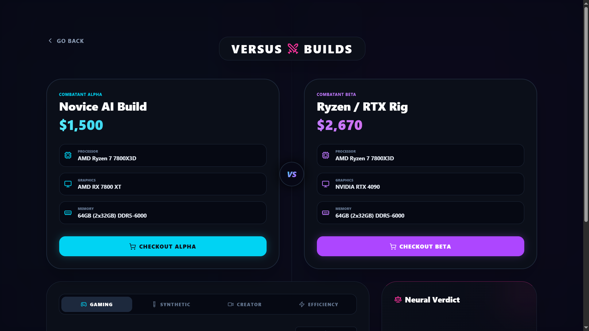
  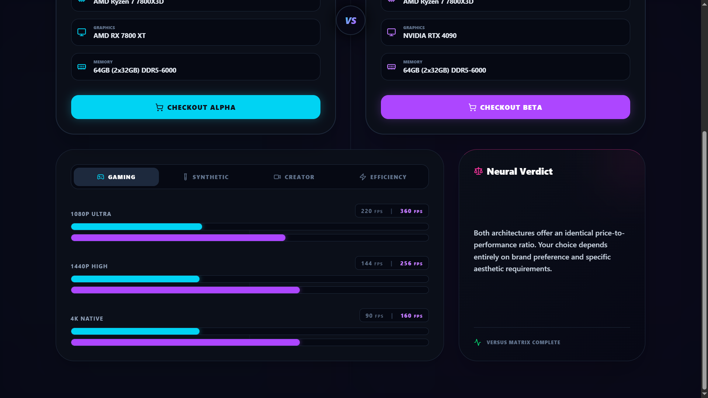
</div>

---

### 🛒 5. Live Retailer Market Pricing
Hardware prices shift constantly. The built-in pricing engine compares current pricing across:

- **Amazon**
- **Newegg**
- **Best Buy**

Includes real-time variance alerts to flag price gouging, out-of-stock spikes, or flash discount opportunities.

<div align="center">
  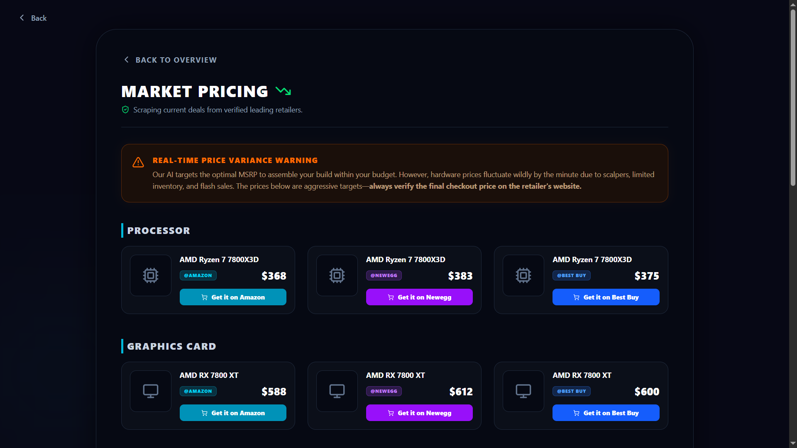
</div>

---

### 📦 6. Saved Builds Hangar
Your personal workspace to curate, review, load, and manage custom loadouts. Filter through previous iterations, launch comparisons, or generate shareable build links.

<div align="center">
  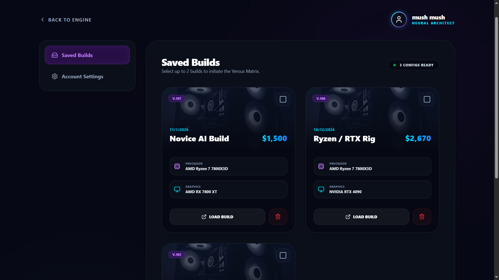
  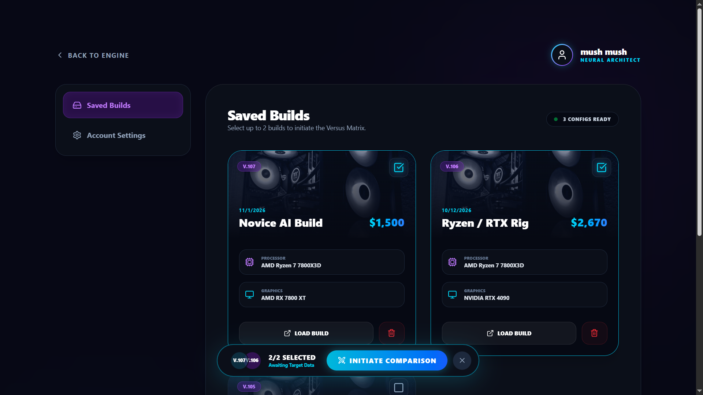
</div>

---

## 📸 Complete Screenshot Gallery

<details>
<summary><b>Click to expand all interface previews</b></summary>

<br />

| Screen | Preview | Description |
| :--- | :--- | :--- |
| **How the Engine Works** | 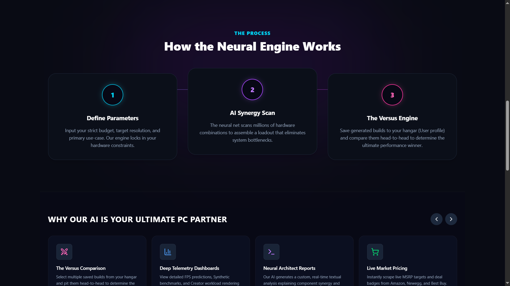 | 3-step pipeline: Parameter definition, synergy scan, and versus comparison |
| **Core Capabilities Grid** | 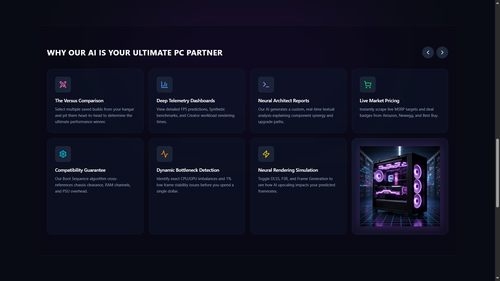 | Complete feature matrix & hardware safety checks |
| **Enthusiast Configurator** | 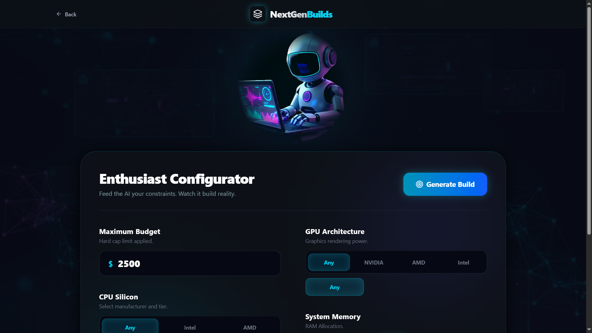 | Detailed silicon, GPU architecture, and budget parameters |
| **Enthusiast Loadout** | 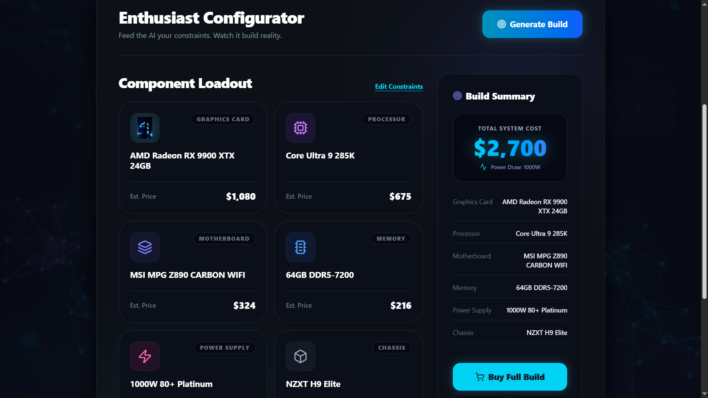 | Full system component breakdown and wattage metrics |
| **Recommended Loadout** | 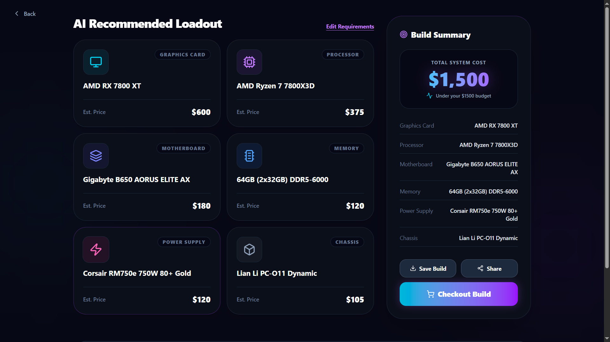 | Balanced component recommendation with pricing totals |
| **Social Reviews** | 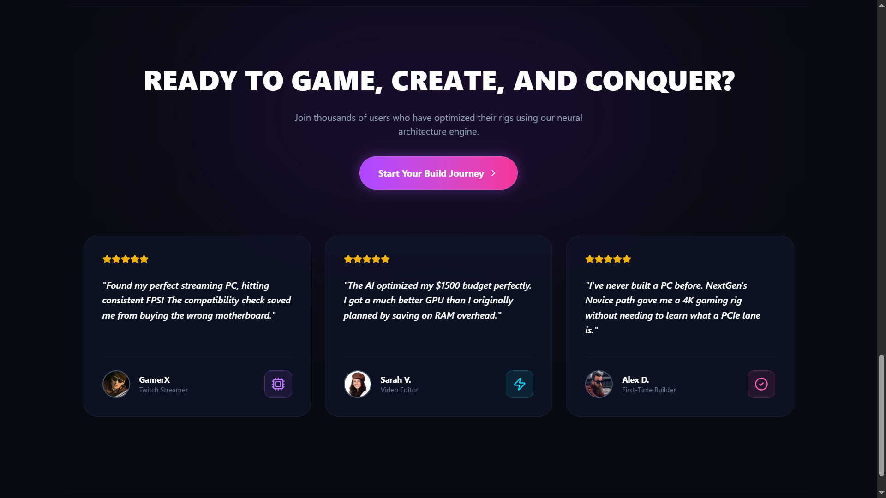 | Community feedback and build journey entry |
| **Calculation Loader** | 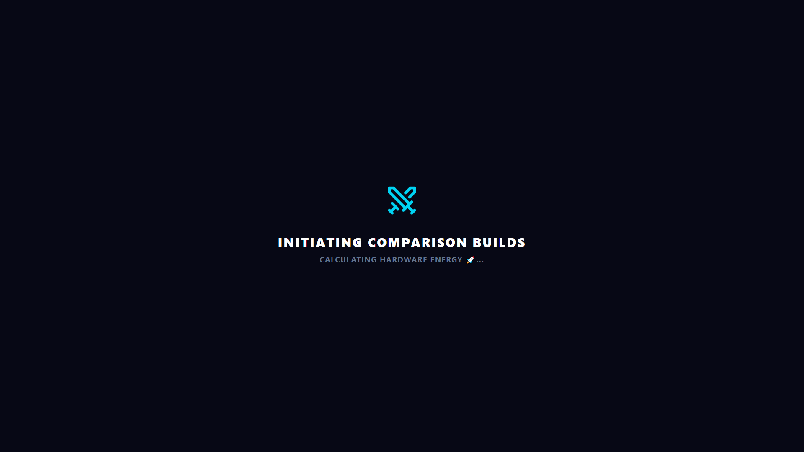 | Hardware energy simulation transition state |

</details>

---

## 🏗️ System Architecture

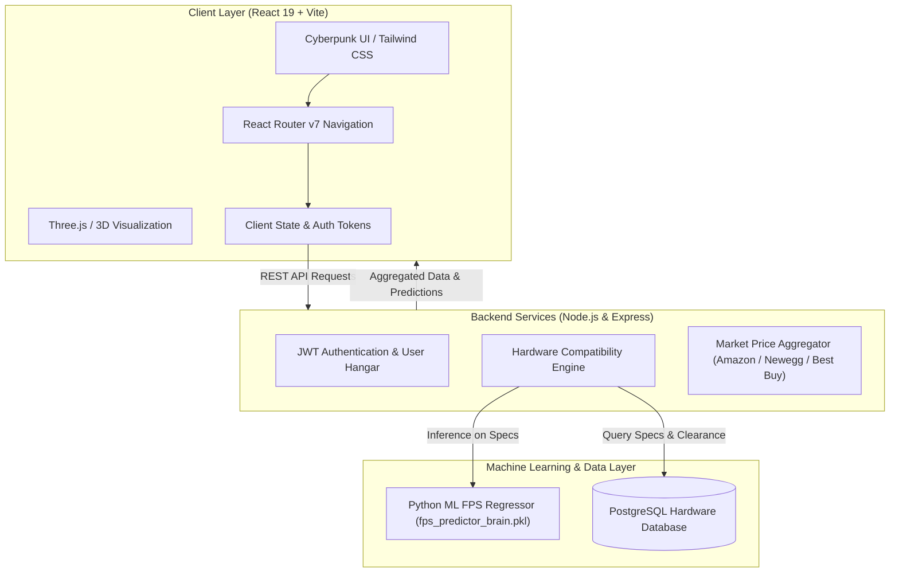

---

## 🛠️ Tech Stack

### Frontend
- **Framework:** [React 19](https://react.dev/) + [Vite 7](https://vitejs.dev/)
- **Styling:** [Tailwind CSS v4](https://tailwindcss.com/) with custom dark cyberpunk aesthetic
- **Routing:** [React Router v7](https://reactrouter.com/)
- **Icons:** [Lucide React](https://lucide.dev/)
- **3D & Graphics:** [Three.js](https://threejs.org/) & [@react-three/fiber](https://docs.pmnd.rs/react-three-fiber)
- **Animations:** [Lottie React](https://github.com/Gamote/lottie-react)

### Backend & ML Core
- **Server:** Node.js, Express.js
- **Database:** PostgreSQL (Cloud instance with connection pooling)
- **ML Subsystem:** Python 3, Scikit-learn trained regression model (`fps_predictor_brain.pkl`)
- **Authentication:** JSON Web Tokens (JWT) + Bcrypt password hashing

---

## 🚀 Getting Started

Follow these steps to run NextGen Builds locally on your machine.

### Prerequisites
- [Node.js](https://nodejs.org/) (version 18 or higher recommended)
- [npm](https://www.npmjs.com/) or [pnpm](https://pnpm.io/)
- Python 3.9+ (if running the local ML prediction engine)

### Installation

1. **Clone the repository:**
   ```bash
   git clone https://github.com/alisami200092/nextgen-builds-frontend.git
   cd nextgen-builds-frontend
   ```

2. **Install frontend dependencies:**
   ```bash
   npm install
   ```

3. **Configure Environment Variables:**
   Create a `.env` file in the root directory:
   ```env
   VITE_API_BASE_URL=http://localhost:5000
   ```

4. **Start the development server:**
   ```bash
   npm run dev
   ```

5. **Open in your browser:**
   Navigate to `http://localhost:5173` to start exploring builds.

---

## 📜 Available Scripts

| Command | Action |
| :--- | :--- |
| `npm run dev` | Starts Vite local development server with Hot Module Replacement |
| `npm run build` | Compiles and bundles production-ready assets into `/dist` |
| `npm run preview` | Previews the local production build |
| `npm run lint` | Runs ESLint across the codebase |

---

## 🗺️ Project Roadmap

- [x] Dual builder pathways (Novice Smart Assistant & Pro Enthusiast)
- [x] Diagnostic Terminal with CPU/GPU bottleneck and 1% low calculations
- [x] Versus Engine comparing gaming, synthetic, and creator workloads
- [x] Real-time retailer price comparison dashboard
- [x] Personal Saved Builds hangar with profile management
- [ ] Interactive 3D chassis visualizer with customizable AR RGB lighting
- [ ] Automated price-drop notifications via Discord webhooks
- [ ] Community build sharing with public upvoting and commentary

---

## 👨‍💻 Author

**Ali Sami**  
GitHub: [@alisami200092](https://github.com/alisami200092)

Contributions, feature suggestions, and pull requests are warmly welcomed! If you find this project helpful or inspiring, feel free to give the repository a ⭐.

---

## 📄 License

This project is licensed under the [MIT License](LICENSE).
